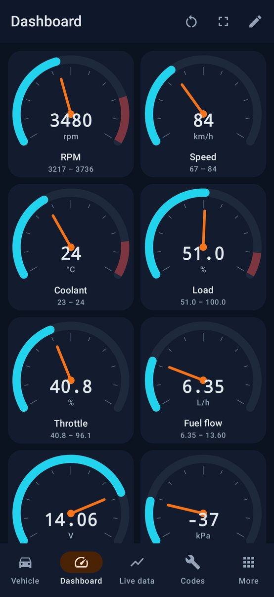
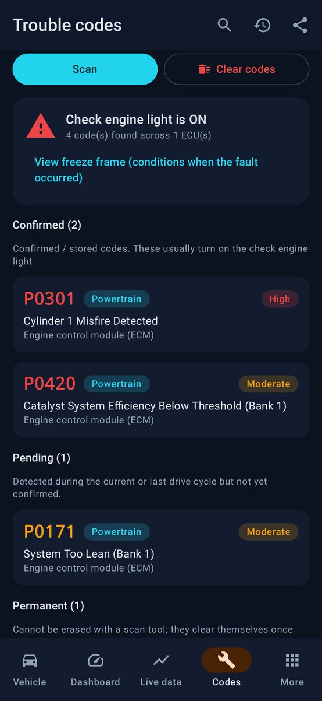
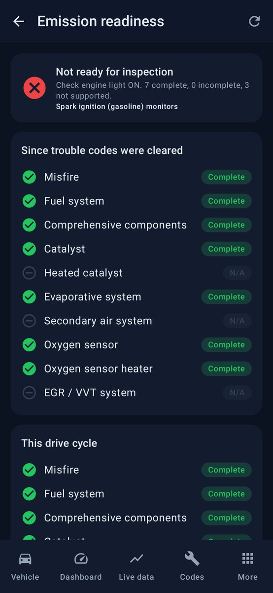
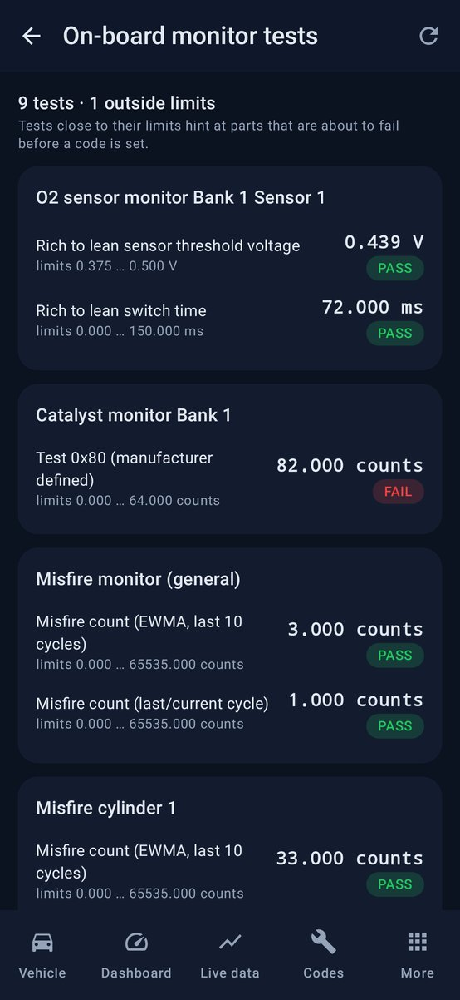

# OpenOBD

A complete, free and open-source **OBD-II car diagnostics app for Android**. It works with
ELM327-compatible adapters over **Bluetooth Classic, Bluetooth LE and Wi-Fi**. Read and clear trouble
codes, watch live sensors on configurable gauges, log data, check emissions readiness, and more,
with no ads, subscriptions or paywalls.

| Vehicle | Dashboard | Live data | Trouble codes | Readiness | Mode 06 |
|---|---|---|---|---|---|
|  |  |  |  |  |  |

## Features

**New in 1.5**
- **Used car & pre-ITV check** with a PDF report: codes in every module, codes cleared recently to hide faults, permanent codes, monitor readiness, VIN consistency across modules, odometer, battery and charging
- **Explained codes**: a *can I keep driving?* verdict and causes ranked with your car's own data (fuel trims at idle vs load, misfire counters per cylinder, catalyst test, warm-up, trip length, voltage)
- Optional **AI assistant** (Claude, with your own API key; only codes, values and car model are sent)
- **Car health trends**: battery at rest, charging voltage, idle fuel trims and rpm, warm-up time and misfires, compared with the car's own baseline
- **Opel / Vauxhall (GM Global A)**: GMLAN trouble codes (\$A9) and clearing in every module, 0x24x addressing, MS-CAN at 95.2 kbps with HS/MS switch adapters
- **Diesel particulate filter helper** (live regeneration conditions, regeneration detection), service guides, **identifier explorer** for manufacturer data
- Dashboard layouts (Everyday, Diesel, Economy, Performance, Temperatures) and big-number tiles, black AMOLED theme, tablet layout, setup wizard, backup & restore, log viewer with replay and before/after comparison

**Diagnostics**
- Read **confirmed, pending and permanent** trouble codes (services 03 / 07 / 0A) from **every ECU** (engine, transmission, hybrid …)
- **Clear codes** and the check-engine light (service 04), with negative-response handling ("turn engine off, ignition on")
- Offline database of **1,300+ generic codes** (P0/P2/P3/U0/B0/C0), plus causes, severity and repair tips for the most common ones
- **Freeze frame** data (service 02): the conditions when the fault was stored
- **Emission readiness / smog check** monitors since clear and for this drive cycle, with a pass/fail verdict
- **Mode 06 on-board monitor tests**: catalyst, O2 sensors, EVAP, and **misfire counts per cylinder**
- **Vehicle info** (service 09): VIN with decoder (make, model year, country, check digit), calibration IDs, CVNs, ECU names, in-use performance counters
- Shareable text report, plus a local **scan history** that shows when codes come back

**Brand-specific features**
- **Brand selector** with automatic detection from the VIN (50 brands, grouped into families that share diagnostic architecture)
- **Module scanner**: read and clear codes in ABS, airbag, body, cluster, steering, climate, parking, EV battery/charger and other modules
  over UDS (ISO 14229) with automatic KWP2000 / OBD fallback. Known addresses for Ford/Lincoln, Mazda, the VW group (VW/Audi/Škoda/SEAT/Cupra/Porsche),
  Hyundai/Kia/Genesis, Toyota/Lexus, Nissan/Infiniti, Renault/Dacia and GM
- **HS/MS-CAN switch adapters** (the common "ELM327 switch" for Ford/Lincoln/Mazda): guided switching to the medium-speed bus
  for climate, door, SYNC and audio modules, with live data paused and safely resumed when you switch back
- **Adapter check**: tests which commands your adapter really supports (many "v1.4/v1.5" adapters are clones), and the app falls back
  automatically (e.g. CAN filter/mask when `ATCRA` is missing)
- **Discover modules**: probes every diagnostic CAN address, so it finds the modules on any brand
- Module **freeze frames and counters**, plus "what to check" hints based on the failure type
- UDS codes with **failure type** ("C0035-31: left front wheel speed sensor, no signal") and status (active, confirmed, pending, warning lamp)
- **Module identification**: part number, software and hardware versions, serial and VIN, plus a raw data-identifier reader
- **Manufacturer-specific code descriptions** for Ford, Toyota, Honda, Nissan, GM, Chrysler and Hyundai/Kia
- **Custom / brand PIDs** with a full equation engine and **Torque CSV import/export**, so community PID packs (EV battery health,
  transmission temperature, DPF soot …) show up in live data, gauges, charts and logs
- Read-only by design: no coding or adaptations, which could disable a module. Code clearing is the only write

**Find your car (model & specifications)**
- Pick your country: **every EU country, Norway and Iceland**, including Spain, can browse the official catalog of every car
  registered there (EEA open data: make → model → year → version, with engine, power, weight, CO₂ and official consumption)
- **Netherlands**: licence-plate lookup (RDW). **UK**: licence-plate lookup with a free DVLA key. **US/Canada**: VIN decoding (NHTSA)
  and the EPA fuel-economy catalog. Anywhere: manual entry
- Specs are editable and saved per car. They feed fuel calculations (fuel type, engine size), compare official vs real
  consumption in the fuel log, and create inspection reminders
- Spain: next **ITV** date and estimated **DGT environmental label**

**Garage and ownership**
- Several cars, picked automatically by VIN, each with its own brand settings, custom PIDs, modules and history
- Maintenance reminders by distance and time, a fuel log with real full-to-full consumption and costs
- Trip history saved automatically, with a GPS track on an OpenStreetMap map
- Home-screen widget: codes, next service and last trip

**Live data**
- The **full SAE J1979 service 01 PID table** (0x01–0xA6+), 217 sensors including diesel (DPF, boost, EGT, NOx, DEF), hybrid and wide-band O2
- Calculated sensors: **fuel flow, instant L/100 km / mpg, boost, power, torque, AFR**, and speed-density airflow for cars without a MAF sensor
- **Customisable gauge dashboard** with min/max, red zones and a shift light
- Multi-sensor **real-time charts** (up to 6 lines, 30 s – 15 min)
- **CSV data logging** that keeps running in the background (foreground service) and can be shared or exported
- **HUD mode**: mirrored display for the windshield
- **Trip computer** (distance, fuel used, averages, cost) and **performance timer** (0-100 km/h, 0-60 mph, 80-120, 1/8 and 1/4 mile)
- Threshold **alerts** with vibration (e.g. overheating, low battery)

**Fast and robust connection**
- Automatic protocol detection: CAN 11/29-bit at 250/500k, KWP2000, ISO 9141-2, J1850 PWM/VPW
- **Multi-PID requests** on CAN and response-count hints, so polling is several times faster than one-PID-at-a-time apps
- Works around cheap clones: three RFCOMM connection strategies, BLE characteristic auto-discovery, spaces/headers handled either way
- **OBDLink/STN fast mode** (verified per connection) and a built-in **speed test**
- Raw **terminal** for AT/ST/OBD commands
- **Demo mode** with a simulated car, so you can try every feature without an adapter

**Languages**: English and Spanish (Settings → Language). Generic code descriptions are English.

## Build and install

You need JDK 17+ and the Android SDK (Android Studio installs both).

```bash
./gradlew assembleDebug
```

Install `app/build/outputs/apk/debug/app-debug.apk` on your phone (`adb install`, or copy it over
and allow installs from unknown sources). Every push also builds the APK on GitHub Actions, so you can
download it from the run's artifacts.

To sign with your own key, publish GitHub releases or submit to Google Play, see
[docs/RELEASING.md](docs/RELEASING.md). Privacy policy: [docs/PRIVACY.md](docs/PRIVACY.md).

## Using it in the car

1. Plug the adapter into the OBD-II port (under the dashboard, near the steering column) and switch the ignition **on**.
2. **Bluetooth Classic**: pair the adapter in Android Bluetooth settings first (PIN 1234 or 0000). **BLE**: just scan in the app. **Wi-Fi**: join the adapter's network.
3. Open OpenOBD, choose the connection type and adapter, then press **Connect**.

If a cheap clone gives odd data, turn off *Multi-PID requests* and *Fast responses* in Settings.

## Architecture

```
app/src/main/java/com/openobd/
├── core/                 Pure Kotlin, unit-tested, no Android dependencies
│   ├── transport/        ObdTransport abstraction + DemoTransport (simulated ELM327 + car)
│   ├── elm/              ELM327 driver, protocol detection, ISO-TP / legacy frame parsing
│   ├── brand/            Brand catalog, module addresses, UDS/KWP module client, manufacturer codes,
│   │                     equation engine, custom PIDs and Torque CSV
│   ├── obd/              PID table, DTC decoding, readiness, freeze frame, Mode 06/09, VIN decoder,
│   │                     calculated sensors, ObdClient (high-level services)
│   └── dtc/              Trouble code description database
├── transport/            Bluetooth Classic (SPP), BLE (GATT), Wi-Fi (TCP), device scanning
├── session/              Connection lifecycle, live-data polling engine, trip computer, perf timer
├── data/                 Settings (DataStore), scan history, CSV logs
├── service/              Foreground service that keeps the connection alive
└── ui/                   Jetpack Compose (Material 3) screens and components
```

## Tests

```bash
./gradlew testDebugUnitTest
```

- Protocol tests cover frame parsing (CAN 11/29-bit, multi-frame, headers on/off, spaces off, J1850), PID formulas, DTC encoding, readiness, VIN decoding and Mode 06.
- `DemoClientTest` runs a full session against the simulated car: discovery, batched PIDs, DTCs, freeze frame, VIN, Mode 06, clearing.
- `ModuleClientTest` scans, clears, identifies and discovers simulated ABS/airbag/body modules and reads custom PIDs, checking OBD polling still works afterwards.
- `BrandTest` covers VIN brand detection, catalog consistency, the equation engine and Torque CSV round-trips.
- `DtcDatabaseTest` pins well-known code descriptions so a bad data import can't ship.
- `UiSmokeTest` (Robolectric) drives the real app through every main screen in demo mode and saves screenshots to `app/build/screenshots`.
- `LegacyProtocolTest` runs full sessions against simulated cars on every OBD-II protocol (29-bit CAN, J1850 PWM/VPW, ISO 9141-2, KWP2000) with their real framing, checksums and DTC/VIN formats.
- `FaultInjectionTest` puts a hostile link between the app and the simulator (fragmented BLE notifications, noise, adapter errors, corrupted digits, lost prompts, late replies, link loss) and checks nothing crashes and every answer is exact again once the faults stop.
- `ParserFuzzTest` throws random and half-valid data at every parser that reads car or user input.
- `AdapterQuirksTest` reproduces behaviour found with the independent emulator below.

Against the independent [ELM327-emulator](https://github.com/Ircama/ELM327-emulator) (also run in CI):

```bash
pip install ELM327-emulator
elm -n 35000 -s car -d
./gradlew testDebugUnitTest --tests '*ExternalEmulatorTest' -PelmEmulator=127.0.0.1:35000
```

On a real device or emulator (CI runs API 26, 30 and 34): `./gradlew connectedDebugAndroidTest`.
A nightly workflow checks the live vehicle data services (`-PliveSpecs=true`) and the newest emulator release.

In the app, *Settings > Demo simulator* makes demo mode imitate an older car or an unreliable adapter, and
*Settings > Troubleshooting > Share debug report* exports the raw adapter traffic when something goes wrong with a real car.

## Disclaimer

Don't use the app while driving. Clearing codes doesn't fix the underlying problem. Code
descriptions are generic (SAE J2012), and manufacturer-specific codes (P1xxx, B1xxx …) can mean
different things on different brands.

## License

MIT. See [LICENSE](LICENSE).
