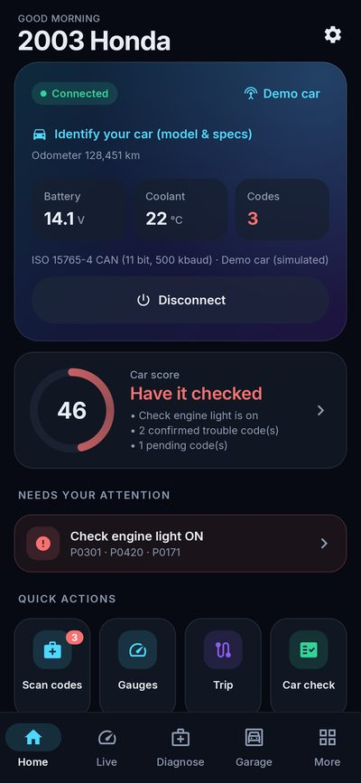
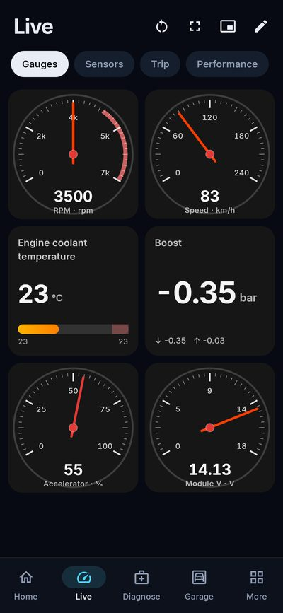
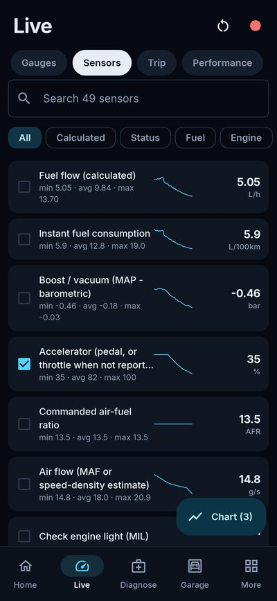
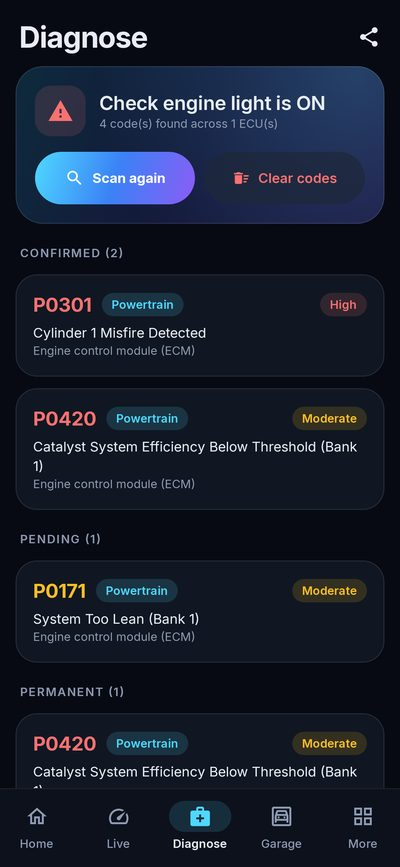
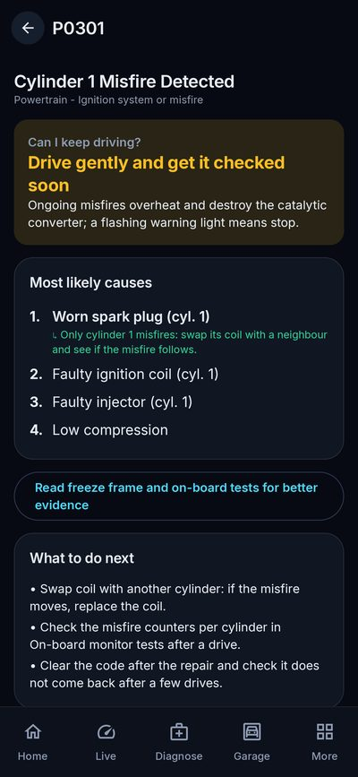
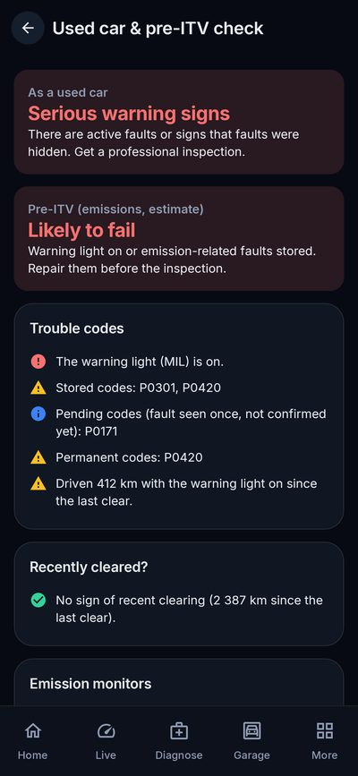
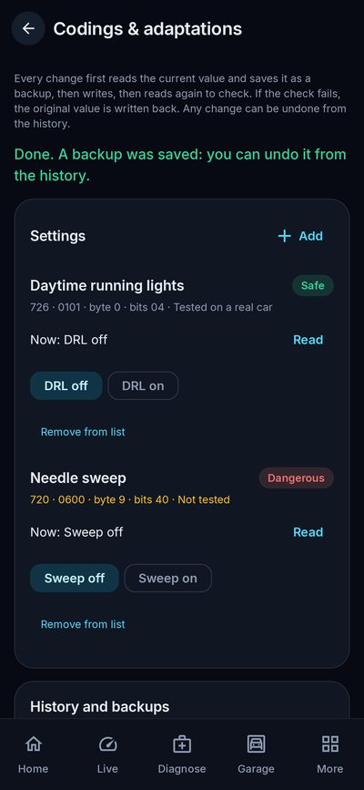
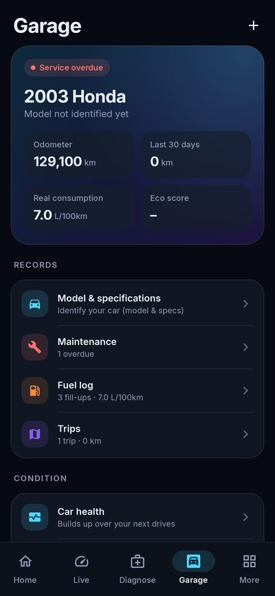

# OpenOBD

**Free and open-source car diagnostics for Android.** Plug a cheap ELM327 adapter into your car's OBD-II port and
read and clear trouble codes in every module, watch live data on gauges you design yourself, check a used car
before you buy it, follow your fuel consumption and maintenance, and change module settings with a backup
behind every change.

No ads, no subscriptions, no account. Your data stays on your phone.

[](https://github.com/Garcy99/OpenOBD/actions/workflows/android.yml)
[](LICENSE)


| Home | Gauges | Live data | Diagnose |
|---|---|---|---|
|  |  |  |  |
| **Explained codes** | **Used car check** | **Codings** | **Garage** |
|  |  |  |  |

## Contents

- [Highlights](#highlights)
- [What you need](#what-you-need)
- [Download and install](#download-and-install)
- [Features](#features)
- [Brand support](#brand-support)
- [Using it in the car](#using-it-in-the-car)
- [Safety](#safety)
- [Contributing](#contributing)
- [Building from source](#building-from-source)
- [Privacy, license and credits](#privacy-license-and-credits)

## Highlights

- **Every module, not just the engine**: ABS, airbag, body, cluster, gearbox, climate, EV battery … over UDS,
  KWP2000 and GMLAN, with known addresses for the main brands and automatic discovery for the rest
- **Codes explained in plain words**: *can I keep driving?*, likely causes ranked with your own car's data, and an
  optional AI assistant
- **Used car & pre-inspection check** with a PDF report: hidden faults, codes cleared recently, readiness, VIN
  consistency across modules
- **Live data on your terms**: 200+ sensors, 7 gauge themes, needle / arc / bar / number styles, colours, ranges
  and warnings per gauge, charts, HUD, floating gauges over other apps
- **Manufacturer data for almost every brand** from the open [OBDb](https://obdb.community) community database:
  battery health, DPF soot and regenerations, tyre pressures, gearbox temperature …
- **Codings & adaptations** with a backup before every write, a check afterwards, automatic restore if it fails
  and undo from the history
- **Garage**: several cars, maintenance and inspection reminders, fuel log with real consumption, trips on a
  map with the values at every point, exported to GPX, an interactive web map, a printable poster or a 3D model
- Works with **Bluetooth, Bluetooth LE, Wi-Fi and USB** adapters, on phones, tablets and Android car head units
- **11 languages** and a **demo car** to try everything without an adapter

## What you need

- An **Android 6.0+** phone, tablet or car head unit
- An **ELM327-compatible OBD-II adapter**: Bluetooth Classic, Bluetooth LE, Wi-Fi or a USB cable (FTDI, CH340,
  PL2303, CP210x). Cheap clones work; OBDLink / STN adapters are faster. An adapter with an **HS/MS-CAN switch**
  reaches the second bus of Ford, Mazda and Opel / Vauxhall
- A car with **OBD-II / EOBD**: petrol cars sold in the EU since 2001, diesels since 2004, US cars since 1996.
  All OBD-II protocols are supported (CAN 11/29-bit, KWP2000, ISO 9141-2, J1850 PWM/VPW). Module features,
  codings and manufacturer data need CAN (most cars from about 2008)

## Download and install

- **APK**: from the [Releases](https://github.com/Garcy99/OpenOBD/releases) page, or the artifacts of the latest
  [build](https://github.com/Garcy99/OpenOBD/actions/workflows/android.yml) (every push builds one).
  Allow installs from unknown sources, open the APK and install
- **From source**: see [Building from source](#building-from-source)

No adapter yet? Choose **Demo** as the connection: a simulated car with codes, modules and live data.

## Features

### Diagnose

- Read **confirmed, pending and permanent** trouble codes from every ECU and clear them (check engine light)
- **Scan all modules** of the car at once and clear codes per module; UDS failure types
  ("C0035-31: wheel speed sensor, no signal"), status, freeze frames and extended data
- Offline database of **1,300+ generic codes** (in English and Spanish) plus manufacturer code tables for Ford,
  Toyota, Honda, Nissan, GM, Chrysler and Hyundai / Kia
- **Explained codes**: severity, a *can I keep driving?* verdict, causes ranked with your car's own data (fuel
  trims at idle vs load, misfire counters per cylinder, catalyst test, warm-up, voltage) and what to check next
- Optional **AI assistant** (Claude, with your own API key) to ask about a code or **identify a warning light**
  from a photo of the dashboard
- **Freeze frame**, **emission readiness** (smog check / ITV / MOT) with a verdict, **Mode 06** on-board tests
  including misfires per cylinder, **vehicle information** (VIN decoder, calibration IDs, CVN, ECU names)
- **Used car & pre-inspection check** with a shareable **PDF**: codes in every module, signs of codes cleared
  recently, permanent codes, readiness, odometer and VIN consistency across modules, battery and charging
- **Car health trends** (battery at rest, charging voltage, idle fuel trims, warm-up, misfires) against the car's
  own baseline, and a **battery & starting test**
- **Scan history** that shows when codes come back

### Live data and gauges

- The full SAE J1979 PID table (**200+ sensors**, including diesel DPF / EGT / NOx / DEF, hybrid and wide-band O2)
- Calculated values: **fuel flow, instant and average consumption** (with a diesel model that learns from your
  fuel-ups), **boost**, power, torque, AFR, accelerator
- **Gauge dashboard you design**: 7 themes (Neon, Classic, Sport, Retro amber, Ice, Racing green, Minimal),
  needle / arc / bar / big-number styles, colour, range, warning above or below and decimals per gauge, and ready-made
  layouts (Everyday, Diesel, Economy, Performance, Temperatures)
- **Charts** with up to 6 lines, **HUD** mode for the windscreen, **floating gauges** over other apps (navigation)
- **Alerts** with vibration and **voice**, **CSV data logging** in the background with a viewer, replay and
  before / after comparison
- **Trip computer**, **performance timer** (0-100 km/h, 0-60 mph, 80-120, 1/8 and 1/4 mile) and an **eco-driving
  score** per trip

### Manufacturer data and codings

- **Community data (OBDb, CC BY-SA 4.0)**: hundreds of manufacturer values per make and model, converted on the
  phone into read-only PIDs: pick the categories you want (battery, DPF, tyres, gearbox …). Suggestions for your
  make and for makes of the same group (Seat ↔ VW, Citroën ↔ Peugeot, Lexus ↔ Toyota …)
- **Particulate filter screen**: regeneration conditions while you drive, detection of a running regeneration,
  and the manufacturer's DPF values (soot load, regenerations, distance since the last one) when available
- **Custom PIDs** with a full equation engine, Torque CSV import / export, and **PID packs** to share what you
  found or download the community catalog
- **Codings & adaptations**: change settings stored in the modules from community packs, a forum coding list or
  your own discoveries, on UDS, KWP2000 and GMLAN modules. Every write reads and saves a backup first, is checked
  afterwards, is written back automatically if the check fails, and can be undone from the history. Dangerous
  changes explain the risk and ask a second time; safe ones (lights, locks, displays) apply straight away
- **Identifier explorer**: find which identifiers a module answers, watch them change while driving, and
  **compare before and after** changing a setting in the car's own menu to find where it is stored

### Garage

- Several cars, picked automatically by VIN, each with its own brand settings, PIDs, codings and history
- **Find your car**: the official catalog of every car registered in the **EU, Norway and Iceland** (EEA open
  data), licence-plate lookup in the **Netherlands** (RDW) and the **UK** (DVLA), VIN decoding and fuel-economy
  data in the **US / Canada** (NHTSA, EPA), or manual entry; a second source cross-checks what the car reports
- **Maintenance reminders** by distance and time; next **inspection** (ITV in Spain) counted from the day you passed
  it, and the Spanish **DGT environmental label**
- **Fuel log** with real full-to-full consumption and costs; real consumption from your trips in the car's specs
- **Trips** saved automatically with a GPS track on an OpenStreetMap map: tap any point for the speed, rpm,
  consumption and time there
- **Export a trip**: **GPX** for any GPS (Garmin, OsmAnd, Komoot, Google Earth) with the car's values in every point;
  an **interactive HTML map** anyone can open in a browser to tap the route, see the same data and save the GPX;
  a **poster** (PDF A3 / SVG) with the route in vectors over the shaded relief of the area; and a **printable 3D map**
  (3MF, multicolour): the real terrain around the route coloured by altitude (Alpine, Forest, Desert or Stone styles),
  with lakes, main roads and, for small areas, buildings from OpenStreetMap, cut as a hexagon, circle or square, with
  the trip's name (and optionally its GPS coordinates) on a plaque. A live 3D preview turns and zooms while you choose
  size, relief exaggeration, maximum height, base thickness and detail; the screen shows the total height and the
  filament list, and every triangle comes painted with its filament number for Bambu Studio, PrusaSlicer and Orca
- **Home-screen widget**, backup and restore

### Connection

- Automatic protocol detection with fallbacks for older cars (K-line) and cars that don't report a VIN
- **Multi-PID requests** on CAN and OBDLink / STN fast mode, so polling is several times faster than one PID at a time
- Works around cheap clones: adapter self-test, several Bluetooth connection strategies, BLE characteristic
  discovery and retries, automatic USB baud-rate detection, hand-built ISO-TP frames where ELM327 chips fall short
  (long writes, BMW / MINI gateway addressing)
- **HS/MS-CAN switch** support (Ford / Mazda 125 kbps, Opel / Vauxhall 95.2 kbps)
- **Terminal** for raw AT / ST / OBD commands, speed test, and a **debug report** with the raw adapter traffic

### Everywhere

- **Languages**: English, Español, Deutsch, Français, Italiano, Português (Brasil), Nederlands, Polski, Türkçe,
  Русский, 中文
- Light, dark and black AMOLED themes; phone, tablet and car head-unit layouts (1024×600 and up)
- Metric and imperial units

## Brand support

Standard OBD-II diagnostics, live data, the used-car check and the garage work on **every OBD-II car**.
What depends on the brand:

| Brands | Modules | Extras |
|---|---|---|
| Ford, Lincoln, Mercury | Known addresses (HS + MS-CAN) | Ford codes, MS-CAN switch |
| Mazda | Known addresses (HS + MS-CAN) | MS-CAN switch |
| Volkswagen, Audi, Seat, Cupra, Škoda, Porsche | Known addresses | |
| Hyundai, Kia, Genesis | Known addresses | Hyundai / Kia codes |
| Toyota, Lexus | Known addresses | Toyota codes |
| Nissan, Infiniti · Renault, Dacia | Known addresses | Nissan codes |
| Chevrolet, Buick, Cadillac, GMC, Holden | Known addresses, GMLAN | GM codes |
| Opel / Vauxhall | GMLAN codes and clearing in every module | GM codes, MS-CAN 95.2 kbps switch |
| BMW, MINI | Main modules through the central gateway (extended addressing) | |
| Peugeot, Citroën, DS, Fiat, Alfa Romeo, Jeep, Chrysler, Dodge, Ram | Discovery | Chrysler codes; secure gateway (2018+) can block clearing |
| Mercedes-Benz, smart · Volvo, Polestar · Honda, Acura · Subaru · Mitsubishi · Suzuki · Jaguar, Land Rover | Discovery | Honda codes |

*Discovery* probes every diagnostic address, so it finds the modules that answer on any brand. Community
manufacturer data (OBDb) exists for every brand above; Tesla is the only brand in the app without it.

## Using it in the car

1. Plug the adapter into the OBD-II port (under the dashboard, near the steering column) and switch the
   ignition **on**.
2. Connect it:
   - **Bluetooth**: pair the adapter in Android's Bluetooth settings first (PIN 1234 or 0000), then choose *BT*.
   - **Bluetooth LE**: choose *BLE* and scan in the app.
   - **Wi-Fi**: join the adapter's network, then choose *Wi-Fi*.
   - **USB** (car head units, whose Bluetooth usually only talks to phones): plug in the cable; Android offers
     to open OpenOBD and the speed is detected automatically.
3. Open OpenOBD and press **Connect**. The app detects the protocol, reads the VIN and picks (or creates) the car
   in your garage.

Where things are:

| Tab | What's there |
|---|---|
| **Home** | Connection, car score, warnings, quick actions |
| **Live** | Gauges, sensors, trip, performance |
| **Diagnose** | Trouble codes, all modules, readiness, freeze frame, Mode 06, used-car check, battery test, warning lights |
| **Garage** | Cars, model & specs, maintenance, fuel log, trips, health |
| **More** | Brand features, **codings & adaptations**, **community data (OBDb)**, particulate filter, guides, HUD, logs, history, custom PIDs, packs, identifier explorer, terminal, settings |

If a cheap clone gives odd data, turn off *Multi-PID requests* and *Fast responses* in Settings, and use
*Settings > Troubleshooting > Share debug report* to send us the adapter traffic.

## Safety

- Don't use the app while driving; set things up while parked.
- Clearing codes doesn't fix the cause. Generic descriptions follow SAE J2012; manufacturer codes (P1xxx, B1xxx …)
  can mean different things on different brands.
- **Codings change settings inside the car's modules.** OpenOBD saves a backup before every write, checks the
  result, writes the backup back if the check fails and lets you undo any change, but a coding that doesn't match
  your car can still switch off a function until it is put back. Use codings tested on your model, with the car
  parked, the engine off and a healthy battery (the app checks what it can).
- OpenOBD never sends security access (seed / key), never writes software and never unlocks protected modules or
  secure gateways. Modules that require it answer "locked" and nothing is changed.
- Community data (OBDb, packs) is not tested on your car: some values may not answer or may be wrong.

## Contributing

Contributions are welcome. Open an [issue](https://github.com/Garcy99/OpenOBD/issues) or a pull request.

- **Bug reports**: include your adapter, car (make, model, year, engine) and, if possible, the debug report from
  *Settings > Troubleshooting*.
- **PID packs and codings**: values you tested on a real car go in [`packs/`](packs/README.md), which documents the
  format (PIDs, codings with protocol, gateway address and session, routines).
- **Translations**: `app/src/main/assets/i18n/<language>.json` maps each English phrase to its translation.
  `TranslationCoverageTest` lists anything missing.
- **Manufacturer values** for every app user are best added to [OBDb](https://github.com/OBDb) itself.

## Building from source

You need JDK 17+ and the Android SDK (Android Studio installs both).

```bash
./gradlew assembleDebug
```

The APK is in `app/build/outputs/apk/debug/`. Signing with your own key, GitHub releases and Google Play:
[docs/RELEASING.md](docs/RELEASING.md).

### Tests

```bash
./gradlew testDebugUnitTest lintDebug
```

Over 230 unit and Robolectric UI tests run against a simulated ELM327 and car (`DemoTransport`) that speaks every
OBD-II protocol, simulates modules over UDS, KWP2000, GMLAN and a BMW-style gateway, writable codings with injected
failures, and an unreliable link (fragmented BLE packets, noise, adapter errors, lost prompts). The UI tests drive
the real app through every screen in demo mode and save screenshots to `app/build/screenshots`.
CI also runs the app on Android emulators (API 23, 30 and 34), against the independent
[ELM327-emulator](https://github.com/Ircama/ELM327-emulator), and nightly against the live vehicle-data services.

### Architecture

```
app/src/main/java/com/openobd/
├── core/          Pure Kotlin, no Android dependencies, unit-tested
│   ├── transport/ Transport abstraction, the simulated car and fault injection
│   ├── elm/       ELM327 driver, protocol detection, frame parsing
│   ├── obd/       PIDs, codes, readiness, freeze frame, Mode 06/09, VIN, calculated sensors
│   ├── brand/     Brands, module client (UDS / KWP2000 / GMLAN), codings engine, equations,
│   │              custom PIDs, packs, OBDb conversion
│   ├── diagnosis/ Explained codes and the car score
│   ├── specs/     Vehicle catalogs and lookups (EEA, RDW, DVLA, NHTSA, EPA)
│   ├── garage/    Cars, maintenance, fuel, trips
│   └── …          Health trends, battery test, reports
├── transport/     Bluetooth Classic, BLE, Wi-Fi, USB serial
├── session/       Connection lifecycle, live-data polling, trips, module features
├── data/          Settings, garage storage, history, logs, AI assistant
├── service/       Foreground service, floating gauges
└── ui/            Jetpack Compose (Material 3) screens and components
```

## Privacy, license and credits

- **Privacy**: no accounts, ads, analytics or tracking. What can leave your phone, and only when you use it, is
  listed in the [privacy policy](docs/PRIVACY.md).
- **License**: MIT, see [LICENSE](LICENSE).
- **Credits**:
  - Manufacturer data: [OBDb](https://obdb.community) contributors, CC BY-SA 4.0. It is downloaded and converted on
    the phone; packs made from it keep that attribution and licence.
    `app/src/main/assets/obdb/index.json` (the list of makes and models) is derived from it.
  - Maps: © [OpenStreetMap](https://www.openstreetmap.org/copyright) contributors. Water, roads and buildings in 3D
    maps come from OpenStreetMap through the [Overpass API](https://overpass-api.de/) (ODbL).
  - Elevation for 3D models: [Terrain Tiles](https://registry.opendata.aws/terrain-tiles/) on AWS Open Data (SRTM,
    GMTED, ETOPO and national elevation models).
  - Vehicle data: European Environment Agency, RDW, DVLA, NHTSA vPIC and US EPA fueleconomy.gov open data.
